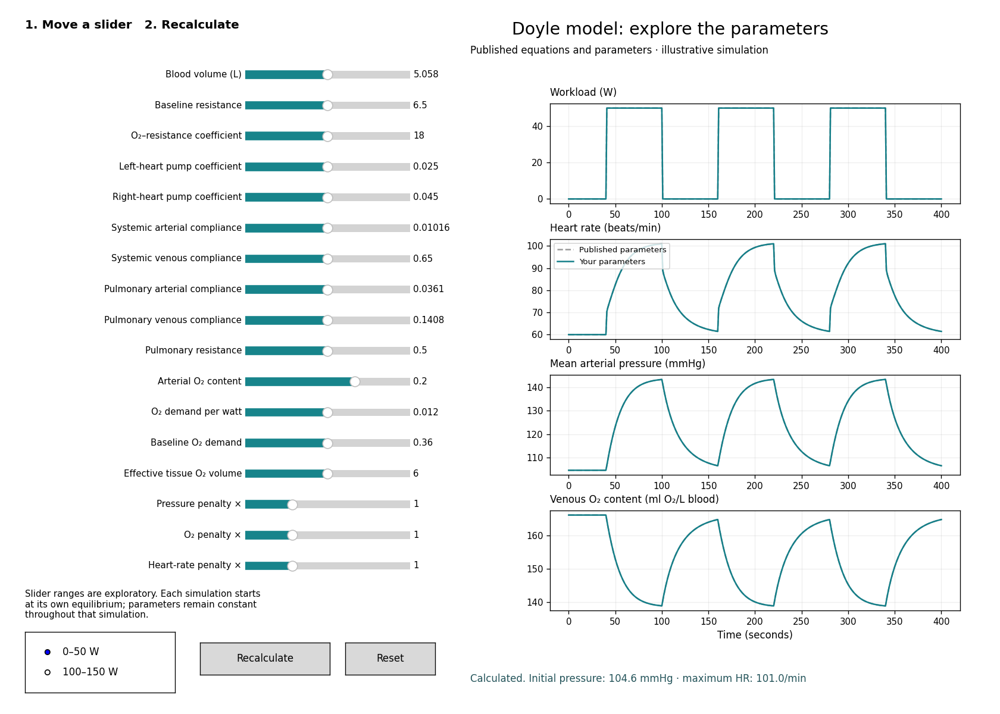

# Doyle cardiovascular model — interactive sliders

An independent Python reconstruction of the circulation and optimal heart-rate controller described by Li et al. (2014), with English parameter sliders. This is the original standalone model, before the pregnancy and pulsatile-heart extensions.



## Run locally

Requires Python 3 and a desktop environment with a working Matplotlib GUI backend.

```bash
python3 -m venv .venv
source .venv/bin/activate
python -m pip install -r requirements.txt
python doyle_slider.py
```

On Windows, activate with `.venv\Scripts\activate` instead. On Linux, your Python installation may also need its Tk GUI package.

Move a slider, then click **Recalculate**. **Reset** restores the defaults. Select either **0–50 W** or **100–150 W** to compare the two demonstration workloads. Grey dashed curves use the published reference parameters; teal curves use your settings. They overlap at the defaults. Each run starts at its own equilibrium.

Sliders cover vascular compliances, heart pumping factors, blood volume, pulmonary and systemic resistance parameters, oxygen content and demand, and the controller penalty weights. The ranges are exploratory settings, not established clinical bounds. Invalid settings retain the last valid curves and display a message.

## Mathematics and provenance

Source: Li N, et al. (2014). *Robust efficiency and actuator saturation explain healthy heart rate control and variability*. Proceedings of the National Academy of Sciences, 111, E3476–E3485. [doi:10.1073/pnas.1401883111](https://doi.org/10.1073/pnas.1401883111).

[Supporting information](https://nali.seas.harvard.edu/file_url/104).

The implementation reconstructs the nonlinear circulation, oxygen balance and feedback control in main-text equations 2, 4 and 5. Physiological values follow SI Table S2; heart parameters follow subject 2 in Table S3; controller weights follow subject 2 in Table S4.

The state is systemic arterial pressure, systemic venous pressure, pulmonary arterial pressure and venous oxygen content. Pulmonary venous pressure follows conservation of total blood volume. The controller linearizes the nonlinear model at the reference equilibrium, solves the continuous algebraic Riccati equation and feeds back the state deviations through heart rate.

The cost uses the sum of squared weighted errors: `Q = diag(qP², 0, 0, qO²)` and `R = qH²`. This is an explicit reconstruction choice: the supporting information's row-vector C and R notation differs from the main text's sum-of-squares expression.

Internal units are minutes, litres, mmHg, beats/min and watts; oxygen content is litres O₂ per litre of blood. Plots show seconds and ml O₂ per litre of blood.

## Interpretation and limits

The grey reference curves are simulations, not measurements from participants. Reference heart rates of 60 and 120 bpm and the repeated 50 W workload steps are demonstration choices; this is not an exact reproduction of Figure 4.

Heart rate is continuous. Total blood volume and arterial oxygen content are fixed during each run. There is no explicit beat-to-beat variability, respiration, neural baroreflex, renal regulation or pregnancy adaptation. Venous oxygen content is not pulse-oximeter saturation (SpO₂). The code rejects nonphysical trajectories rather than clipping heart rate; it does not implement explicit actuator saturation. This educational reconstruction is not a clinical prediction tool.

## Other commands

```bash
# Save a headless preview
python doyle_slider.py --preview

# Generate fixed-rate / feedback comparisons, CSV files and parameter report
MPLBACKEND=Agg python doyle_model.py
```

The numerical model checks equilibrium balances, local closed-loop stability, the Riccati residual and physical domains. These checks do not establish agreement with measured human data.

## Repository contents

- `doyle_model.py`: equations, equilibrium, controller and integration.
- `doyle_slider.py`: English desktop slider application.
- `requirements.txt`: Python dependencies.
- `slider_preview.png`: application preview.

## License

This repository’s original code and documentation are released under the [MIT License](LICENSE). Copyright (c) 2026 Andrea Loewendorf.

The cited paper and supporting information retain their respective rights; the MIT License does not relicense those publications. Please retain the scientific source attribution when reusing this reconstruction.
